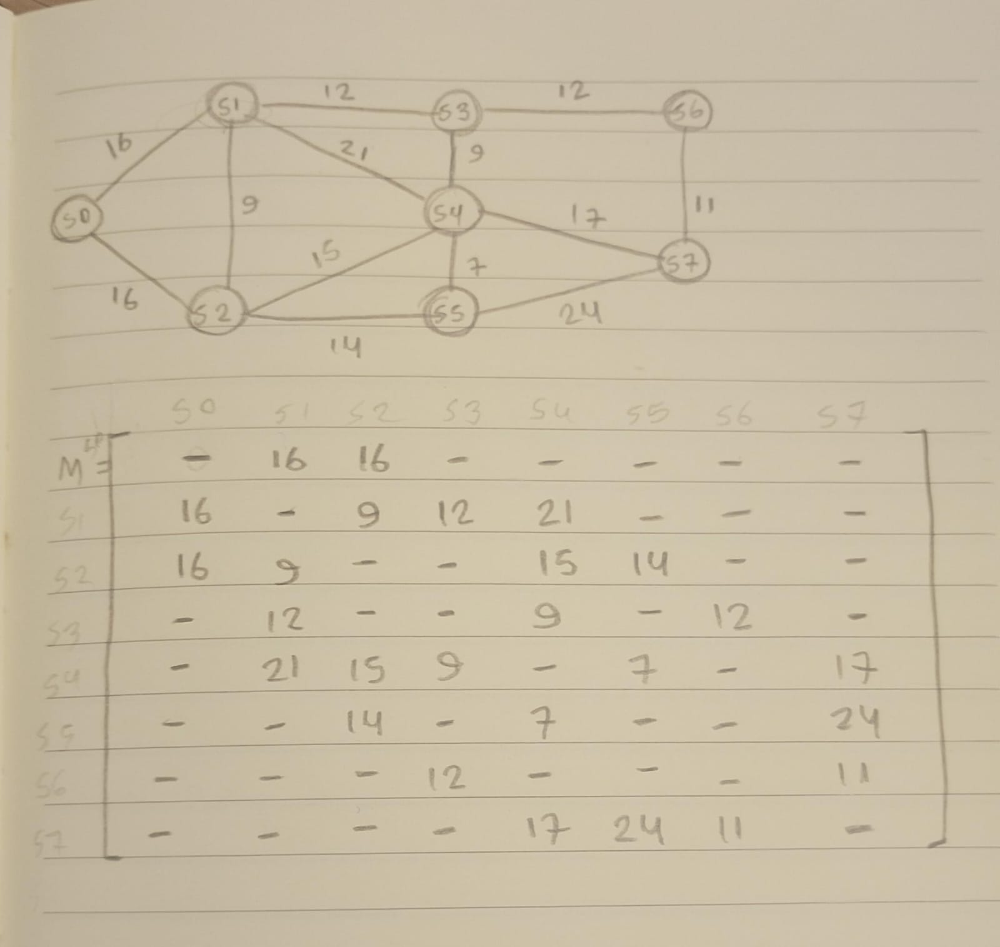
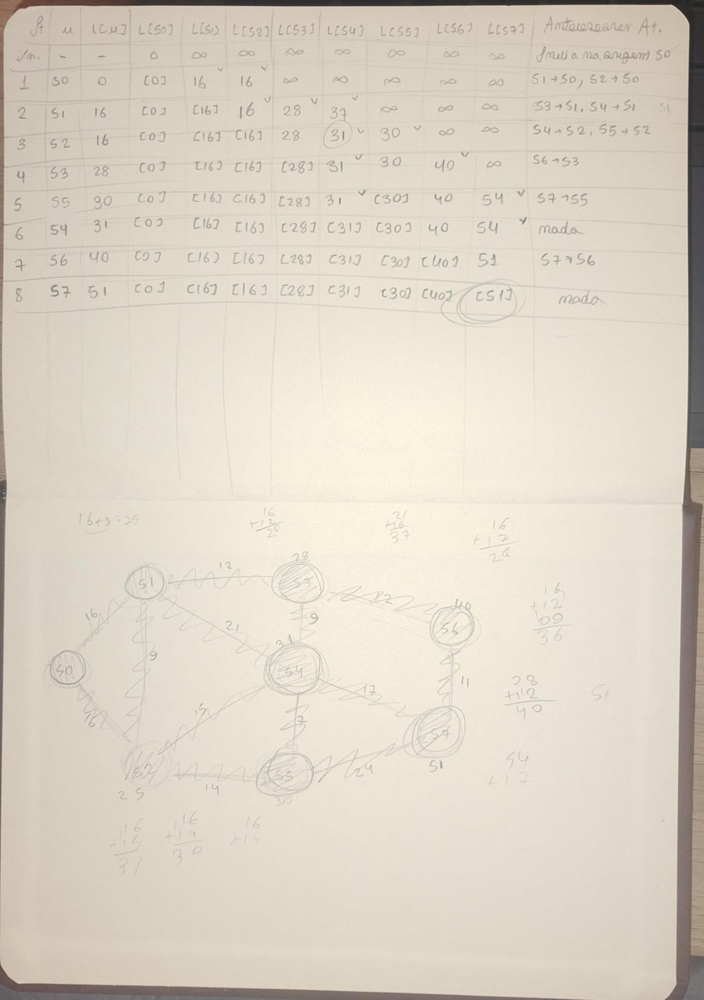
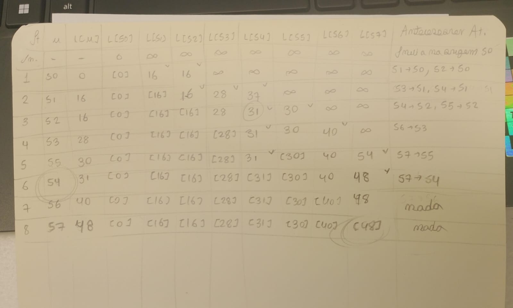
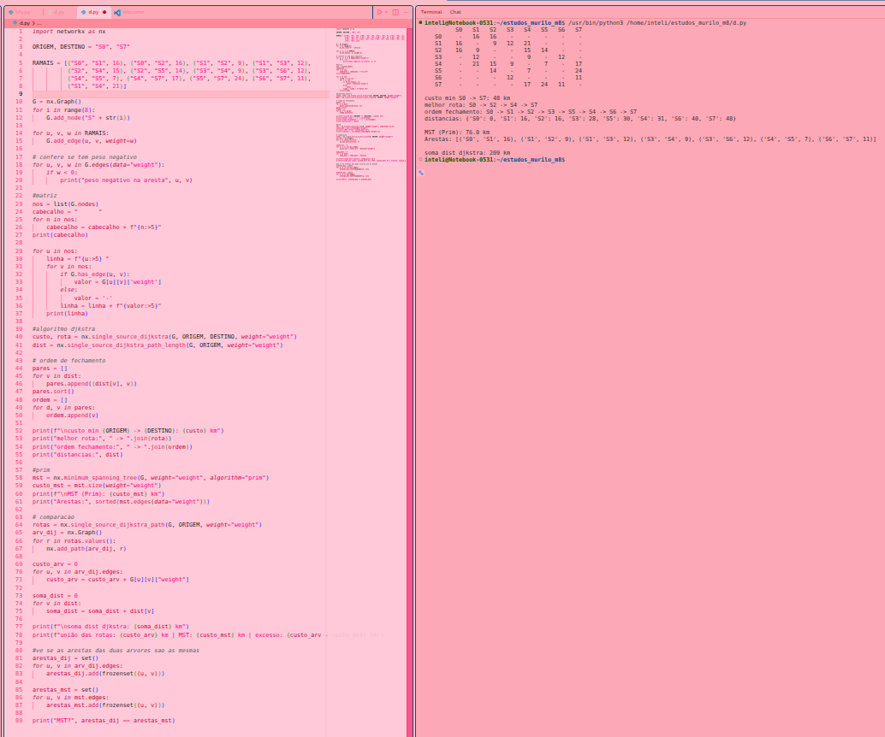
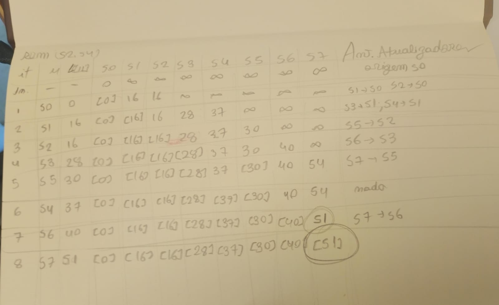
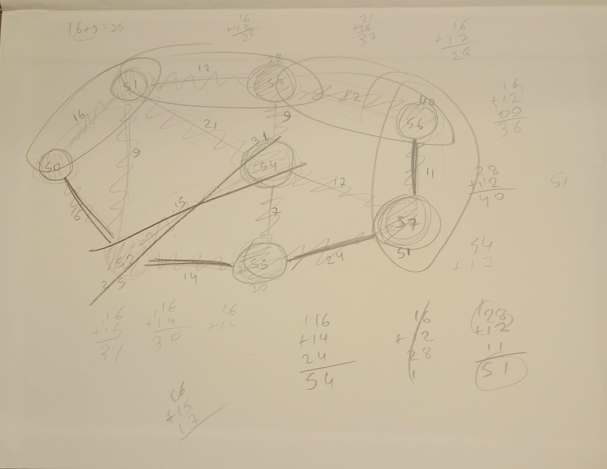
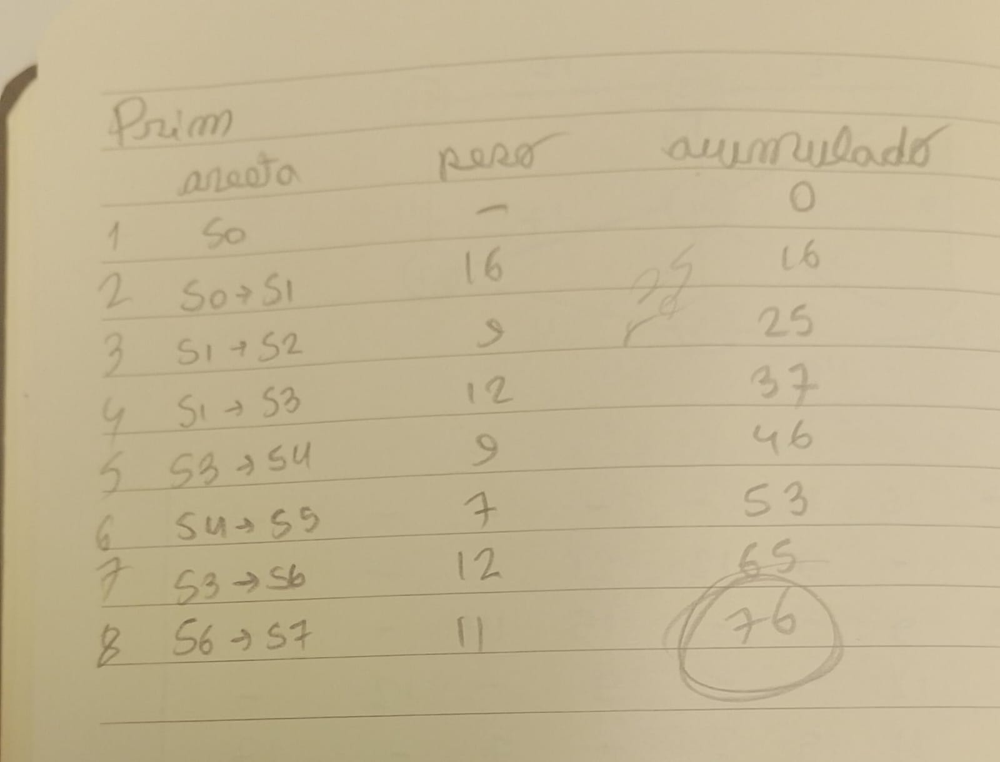

# Atividade Ponderada - Engenharia da Computação - Algoritmos de Grafos

**Nome:** Nicolli Venino Santana

**RA:** A2025.1A.0176

# Erros que descobri durante o processo e como corrigi:
Antes de codar, resolvi a etapa 2 da atividade, que demanda fazer o algoritmo a mão, com uma tabela de apoio. Foi uma etapa que exigia bastante atenção para não cometer erros, e fiz ela com o fluxo de pensamento: primeiro tomo como meu vértice de análise atual aquele que tem menor custo acumulado até agora (para empate eu considerei o de menor ordem). Tomando esse vértice como meu atual, quais são os vizinhos dele que ainda não foram visitados (fui marcando como fechado com o colchete na tabela e pintando o vértice no prórpio grafo em paralelo). Então eu marcava com um "v" bem pequeno no campo da tabela da linha do meu vértice de análise atual quem eram os visinhos, para fazer o recalculo e atualizar sim ou não. Os demais vértices que não eram vizinhos não visitados do meu de análise atual eu copiava o valor da linha acima. Nesse processo, eu acabei errando exatamente uma única análise, quando eu estava analisando o vértice S4, ao recalcular o custo para S7 (meu destino), eu acabei não atualizando, de forma equivocada. Fui perceber esse erro quando fiz o código e o resultado de menor custo e caminho não foram os mesmos, o que instigou a minha reanalise da tabela do algoritmo a mão. Por isso, nessa documentação, você vai ver uma primeira versão do algoritmo a mão, que revela um resultado errado, e uma segunda versão, com o erro apagado e corrigido (ainda bem que eu comecei fazendo de lápis!)
.
# Etapas Obrigatórias:

### 1.1: Tabela de pesos do RA: apresente os 6 dígitos do seu RA (D1 a D6), o destino (S6 ou S7) e os 13 pesos calculados. 

- D1 = 5
- D2 = 1
- D3 = 0
- D4 = 1
- D5 = 7
- D6 = 6
- Origem = S0
- Destino = S7 

Pesos: 

| num | aresta | formula | resultado
| --- | --- | --- | --- |
e1 | (S0, S1) | w1 = 10 + (D6 mod 5) | 16
e2 |(S0, S2) | w2 = 15 + (D5 mod 7) | 16
e3 |(S1, S2) |w3 = 8 + (D4 mod 4) | 9
e4 |(S1, S3) |w4 = 12 + (D3 mod 6) | 12
e5 |(S2, S4) |w5 = 14 + (D2 mod 5) | 15
e6 |(S2, S5) |w6 = 9 + (D1 mod 6) | 14
e7 |(S3, S4) |w7 = 7 + ((D5 + D6) mod 5) | 9
e8 |(S3, S6) |w8 = 11 + ((D4 + D5) mod 6) | 12
e9 |(S4, S5) |w9 = 6 + ((D3 + D4) mod 4) | 7
e10 |(S4, S7) |w10 = 16 + ((D2 + D3) mod 7) | 17
e11 |(S5, S7) |w11 = 18 + ((D1 + D2) mod 8) | 24
e12 |(S6, S7) |w12 = 9 + ((D5 + D1) mod 5) | 11
e13 |(S1, S4) |w13 = 20 + (D6 mod 4)| 21

// Obs: tirei um tempo para fazer uma revisão rápida antes de enviar e percebi que calculei alguns pessos errados, considerando os valores do meu RA. No entanto, conversando com o orientador no momento da atividade, ele informou que não há problema e que posso considerar os pesos que encontrei, já que o que vale, de fato, é o desenvolvimento e entendimento do algoritmo, e o cálculo individual dos pesos configura apenas uma maneira de garantir que o trabalho de cada aluno seja diferente um do outro.

### 1,2 e 1.3 e 1.4: Diagrama topológico: desenhe o grafo com os 8 vértices (S0 a S7) e as 13 arestas rotuladas com seus pesos. Matriz de pesos 8×8: construa a grade completa, indexada de S0 a S7 e garanta M[i][j] = M[j][i]. Pares sem conexão direta devem conter explicitamente NULO (ou "—"). 



Validei com o código posteriormente.

### 2. Teste de mesa tabular de Dijkstra

#### Primeira Versão 
Essa versão, conforme comentado no inicío, contém um erro na linha de análise do S4, para a atualização do custo até o S7 (eu acabei não atualizando, mas existia um caminho mais curto que 51 por S4, pela aresta de peso 17, que resultava em 48.



#### Segunda Versão
Essa versão é com o erro apagado e corrijido.



### 3.TAD e algoritmos: implemente em código executável (por exemplo, Python) o TAD Grafo (Aula 01) e os algoritmos de Dijkstra e Prim (Aula 03). O uso assistido de LLM é permitido, desde que acompanhado de auditoria crítica documentada.



Codei no vscode, conforme a imagem abaixo e usei como apoio de sintaxe o código que fiz no exercício que o orientador enviou um dia antes da atividade para treinar.

```
import networkx as nx

ORIGEM, DESTINO = "S0", "S7"

RAMAIS = [("S0", "S1", 16), ("S0", "S2", 16), ("S1", "S2", 9), ("S1", "S3", 12),
          ("S2", "S4", 15), ("S2", "S5", 14), ("S3", "S4", 9), ("S3", "S6", 12),
          ("S4", "S5", 7), ("S4", "S7", 17), ("S5", "S7", 24), ("S6", "S7", 11),
          ("S1", "S4", 21)]

G = nx.Graph()
for i in range(8):
    G.add_node("S" + str(i))

for u, v, w in RAMAIS:
    G.add_edge(u, v, weight=w)

# confere se tem peso negativo
for u, v, w in G.edges(data="weight"):
    if w < 0:
        print("peso negativo na aresta", u, v)

#matriz
nos = list(G.nodes)
cabecalho = "      "
for n in nos:
    cabecalho = cabecalho + f"{n:>5}"
print(cabecalho)

for u in nos:
    linha = f"{u:>5} "
    for v in nos:
        if G.has_edge(u, v):
            valor = G[u][v]['weight']
        else:
            valor = '-'
        linha = linha + f"{valor:>5}"
    print(linha)

#algoritmo djkstra
custo, rota = nx.single_source_dijkstra(G, ORIGEM, DESTINO, weight="weight")
dist = nx.single_source_dijkstra_path_length(G, ORIGEM, weight="weight")

# ordem de fechamento 
pares = []
for v in dist:
    pares.append((dist[v], v))
pares.sort()
ordem = []
for d, v in pares:
    ordem.append(v)

print(f"\ncusto min {ORIGEM} -> {DESTINO}: {custo} km")
print("melhor rota:", " -> ".join(rota))
print("ordem fechamento:", " -> ".join(ordem))
print("distancias:", dist)

#prim
mst = nx.minimum_spanning_tree(G, weight="weight", algorithm="prim")
custo_mst = mst.size(weight="weight")
print(f"\nMST (Prim): {custo_mst} km")
print("Arestas:", sorted(mst.edges(data="weight")))

# comparacao
rotas = nx.single_source_dijkstra_path(G, ORIGEM, weight="weight")
arv_dij = nx.Graph()
for r in rotas.values():
    nx.add_path(arv_dij, r)

custo_arv = 0
for u, v in arv_dij.edges:
    custo_arv = custo_arv + G[u][v]["weight"]

soma_dist = 0
for v in dist:
    soma_dist = soma_dist + dist[v]

print(f"\nsoma dist djkstra: {soma_dist} km")
print(f"união das rotas: {custo_arv} km | MST: {custo_mst} km | excesso: {custo_arv - custo_mst} km")

#ve se as arestas das duas arvores sao as mesmas
arestas_dij = set()
for u, v in arv_dij.edges:
    arestas_dij.add(frozenset((u, v)))

arestas_mst = set()
for u, v in mst.edges:
    arestas_mst.add(frozenset((u, v)))

print("MST?", arestas_dij == arestas_mst)
```

### 4.1  Qual é a distância total mínima (em km) e a sequência exata de subestações de S0 até o seu destino? Liste a ordem cronológica em que os vértices foram definitivamente fechados pelo Dijkstra.
A distância mínima total para chegar a S7, conforme encontrei é 48km e o caminho é S0 -> S2 -> S4 -> S7. 

### 4.2 Simule a queda de uma torre no ramal e5 = (S2, S4), removendo a aresta (w5 = ∞). Determine a nova rota ótima e calcule o acréscimo de custo em km e em percentual.
51km (acrecsimo de 3km) e o caminho S0 -> S1 -> S3 -> S6 -> S7.





### 4.3 Calcule o custo total da Árvore Geradora Mínima (Prim) que mantém as 8 subestações conectadas. Compare-o com a soma das distâncias de Dijkstra e explique por que a união das rotas radiais não gera a MST.
Fiz essa comparação no código que mostrei na etapa 3 e tive como resultado de saída:

MST (Prim): 76.0 km
soma dist djkstra: 209 km

Também calculei o MST do prim a mão para validar:



Minha conclusão foi que a união das rotas radiais não gera a MST, relacionando com a aula, porque são objetivos diferentes, já que o djkstra minimiza o custo de cada trajeto a partir de S0 e o prim minimiza o custo total para manter todos os vértices conectados. Nesse sentido também, eu notei que o dijkstra usa quatro arestas que a MST descarta, que são S0–S2 (16), S2–S4 (15), S2–S5 (14) e S4–S7 (17) e o MST usa quatro arestas baratas que o Dijkstra não precisa, que são S1–S2 (9), S3–S4 (9), S4–S5 (7) e S6–S7 (11).
